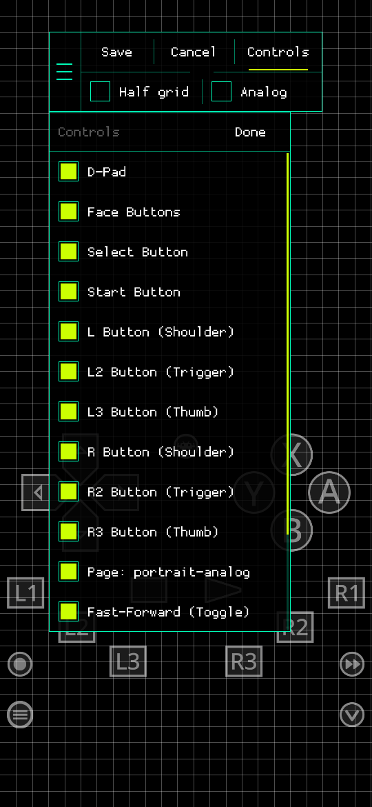
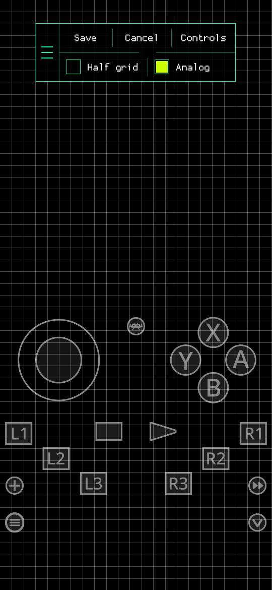
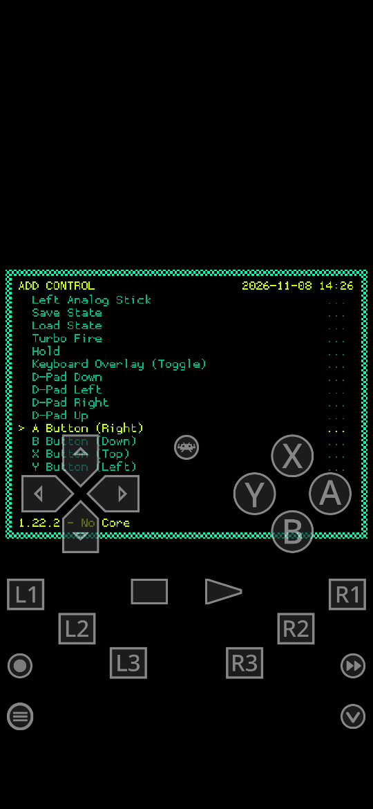

# RetroArch Custom

> **Disclaimer:** this fork was made with [Claude Code](https://claude.com/claude-code),
> Anthropic's AI coding tool. Its changes to RetroArch were written by
> Claude Code at the repository owner's direction. It is not affiliated
> with or supported by the RetroArch/libretro project.

A fork of [RetroArch](https://github.com/libretro/RetroArch) for Android
phones, built around editing the on-screen touch controls. Everything
else is RetroArch as it is upstream; see the
[RetroArch repository](https://github.com/libretro/RetroArch) and
[libretro documentation](https://docs.libretro.com/) for the rest.

## What's new in this fork

### Touch layout editor

Found under **Settings → User Interface → On-Screen Overlay → Touch
Layout**, or **Quick Menu → On-Screen Overlay → Touch Layout** in a game.

- **Edit Layout**: drag the overlay's controls to new places, with or
  without a game running. A control moves with everything that belongs
  to it, so a D-pad or face-button cluster moves as one. Controls do
  nothing while being edited.
- **Grid**: the middle of a control snaps to a grid of 50 square cells
  along the long side of the screen, drawn while editing.
- **Editor bar**, movable by its grip:
  - **Save**: keep the changes and go to the menu.
  - **Cancel**: go back to the last saved layout and go to the menu.
  - **Controls**: a scrolling list to show or hide controls, as part of
    the same edit. Drag the list to scroll it; tap a row to toggle it.
  - **Half grid**: snap to half cells.
  - **Analog**: switch to the overlay's analog-stick page, or back to
    the D-pad page, so either one can be laid out.
- **Layout For**: save a layout for all content, for one core, or for
  one game. A game's layout applies over its core's, which applies over
  the one for all content.
- **Controls**: show or hide each control from the menu.
- **Add Control**: add a control the overlay has on its other pages,
  such as an analog stick, save/load state, turbo or the keyboard. Each
  button of a cluster (A, B, X, Y, the D-pad arrows) can also be added
  on its own, next to the cluster.
- **Save Layout as Profile**: save the layout shown under a name.
- **Load Profile**: put a saved profile in place of the layout chosen in
  Layout For, so one profile can be used for any number of cores or
  games.
- **Delete Profile**: delete a saved profile. Layouts already loaded
  from it are not changed.
- **Reset Layout**: drop the layout chosen in Layout For.

#### Screenshots

Portrait, with the bundled Neo RetroPad overlay and the Highlighter
theme.

<table>
  <tr>
    <td align="center"><br>Touch Layout menu</td>
    <td align="center"><br>Editor, bar and grid</td>
    <td align="center"><br>Controls list</td>
  </tr>
  <tr>
    <td align="center"><br>Analog page</td>
    <td align="center"><br>Add Control</td>
    <td></td>
  </tr>
</table>

Layouts are saved apart from the overlay itself, in
`config/overlay_layouts/` (all content), `config/overlay_layouts/<core>/`
and `config/overlay_layouts/<core>/<game>/`, so updating overlays does
not lose them. Profiles are in
`config/overlay_layouts/profiles/<overlay>/`.

### Android defaults

- Installs as **RetroArch Custom** (`com.retroarch.custom`), alongside
  the Play Store builds.
- RGUI is the default menu, with the bundled **Highlighter** theme
  (**My Theme** is also included).
- The touch controls stay shown over the menu.
- Menu assets, overlays, controller profiles and core info files are
  bundled in the APK.

## Building the Android APK

Needs the Android SDK and NDK 29.0.14206865.

```sh
cd pkg/android/phoenix
./bundle_assets.sh          # fetches and stages the bundled assets
./gradlew assembleCustomRelease \
   -PRELEASE_STORE_FILE=<keystore> -PRELEASE_STORE_PASSWORD=<password> \
   -PRELEASE_KEY_ALIAS=<alias> -PRELEASE_KEY_PASSWORD=<password>
```

The APK is written to `build/outputs/apk/custom/release/`. Sign every
build with the same key, or Android will not install it over the
previous one.

## License

RetroArch is licensed under the GNU General Public License v3; see
[COPYING](COPYING). This fork is under the same license.
