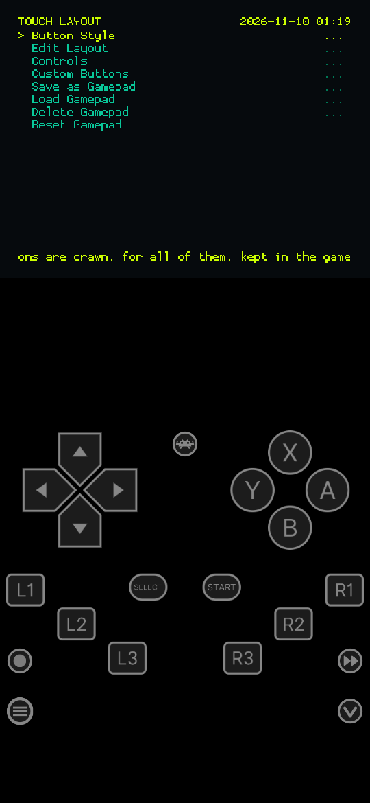
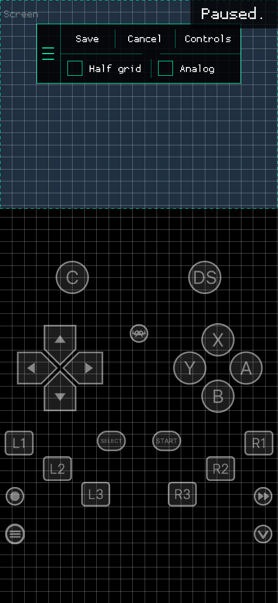
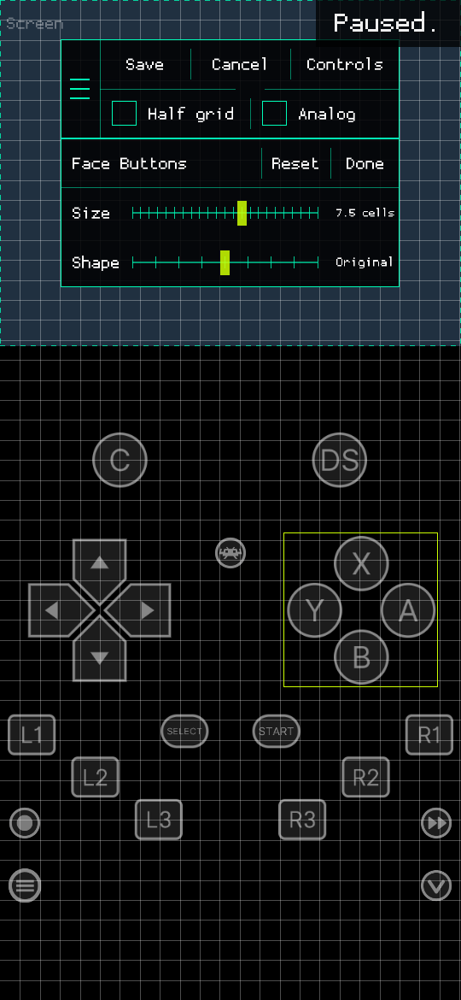
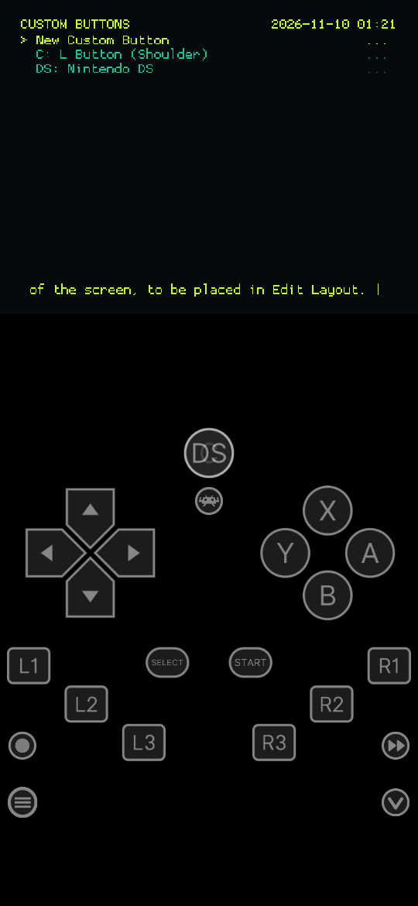
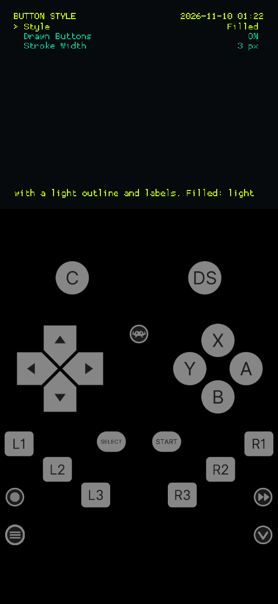
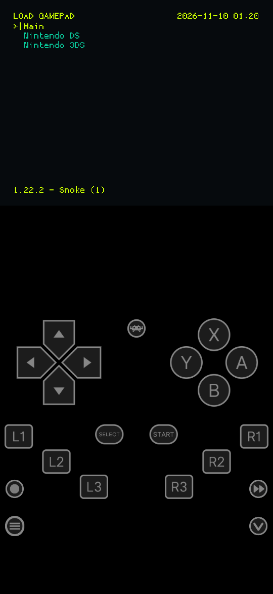
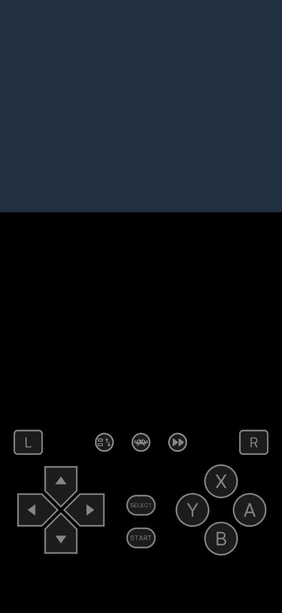

# RetroArch Custom

> **Disclaimer:** this fork was made with [Claude Code](https://claude.com/claude-code),
> Anthropic's AI coding tool. Its changes to RetroArch were written by
> Claude Code at the repository owner's direction. It is not affiliated
> with or supported by the RetroArch/libretro project.

A fork of [RetroArch](https://github.com/libretro/RetroArch) for Android
phones, built around editing the on-screen touch controls. Everything
else is RetroArch as it is upstream; see the
[RetroArch repository](https://github.com/libretro/RetroArch) and
[libretro documentation](https://docs.libretro.com/) for the rest.

## What's new in this fork

### Touch layout editor

Found under **Settings → User Interface → On-Screen Overlay → Touch
Layout**, or **Quick Menu → On-Screen Overlay → Touch Layout** in a game.

- **Edit Layout**: drag the overlay's controls to new places, with or
  without a game running. A control moves with everything that belongs
  to it, so a D-pad or face-button cluster moves as one. Controls do
  nothing while being edited.
- **Grid**: the middle of a control snaps to a grid of 50 square cells
  along the long side of the screen, drawn while editing.
- **Sizing**: tap a control (or a whole D-pad or face-button cluster)
  to select it; a panel opens under the editor bar with a **Size**
  slider, notched in half grid cells, and a **Shape** slider from wider
  to taller, original in the middle. **Reset** puts it back as the
  overlay made it, **Done** closes the panel.
- **Game screen**: the screen is the dashed box behind the controls.
  Tap it to select it, then drag it (snapped to the grid) or set its
  **Width** and **Height** in grid cells. The game keeps its shape
  inside it, and the menu follows it too. **Reset** keeps the width
  and sets the height to the game's own shape, so no bars are left.
- **Editor bar**, movable by its grip:
  - **Save**: keep the changes and go to the menu.
  - **Cancel**: go back to the last saved layout and go to the menu.
  - **Controls**: the same list as the menu's, as part of the same
    edit (Cancel undoes what was added too). Drag the list to scroll
    it; tap a row to toggle it.
  - **Half grid**: snap to half cells.
  - **Analog**: switch to the overlay's analog-stick page, or back to
    the D-pad page, so either one can be laid out.
- **Button Style**, for all the buttons of the gamepad shown:
  - **Style**: Outline (dark buttons, light outline and labels) or
    Filled (light buttons, dark labels).
  - **Drawn Buttons** (on by default): the face buttons, shoulder
    buttons, Start, Select, D-pad and sticks are drawn in code, with
    their labels as text in the menu's font, rather than shown from the
    overlay's images. They stay sharp at any size, and a button made
    wider or taller keeps round ends and upright letters: it is drawn
    again when a slider is let go. Hotkeys (menu, fast-forward, save
    state, ...) keep their icons, in either style. Off shows the images.
  - **Stroke Width**: the outline of every drawn button, the same
    whatever its size.
- **Controls**: every control in one list, each on or off. First the
  controls of the page shown, then those the overlay has on its other
  pages (an analog stick, save/load state, turbo, the keyboard, ...),
  then each D-pad arrow and face button on its own, next to the
  cluster. Switching on one the page doesn't have yet adds it in the
  middle of the screen, to be dragged into place, on every page of the
  screen's shape (the D-pad, analog and expanded pages).
- **Custom Buttons**: buttons of your own. **New Custom Button**: pick
  what it sends (a button of the gamepad, a hotkey such as
  fast-forward or save state, or a gamepad to switch to), then type
  its label, say "C" sending L1. A gamepad button switches when let go
  of, as Load Gamepad does: until the game closes, or kept with an
  override. It is drawn round with its label and appears in the middle of the
  screen, to be placed and sized in Edit Layout like any control. Each
  one listed opens **Label**, **Input** and **Remove**. They are kept
  in the gamepad, as plain overlay buttons other RetroArch can use
  too (with a blank button image, as only this build draws labels).
- **Hide**: with the controls hidden (the page the hide button goes
  to), the menu can be used by touch again, apart from the show button.
- **Gamepads**: what you lay out is a gamepad, an overlay preset of its
  own (RetroArch's word for an overlay config). Three come built in:
  **Main**, **Nintendo DS** and **Nintendo 3DS**; DS and 3DS games
  start on theirs, everything else on Main.
  - **Edit Layout** changes the gamepad shown, for everything using it.
  - **Save as Gamepad**: a copy of the gamepad shown, as laid out, to
    lay out apart, say for one game.
  - **Load Gamepad**: switch gamepads, the way RetroArch's Overlay
    Preset works; the one in use is ticked. While a game runs, the change lasts until it closes;
    to keep it, save an override (Quick Menu > Overrides > Save Core
    Overrides or Save Game Overrides). With no game running, it is the
    gamepad for all content, apart from DS and 3DS cores, which start
    on their own unless an override says otherwise. Picking a gamepad
    file as Overlay Preset (Settings > User Interface > On-Screen
    Overlay) does the same; the files are in `overlays/gamepads/custom`.
  - **Delete Gamepad**: delete one you saved.
  - **Reset Gamepad**: put a built-in gamepad back as it comes. A
    built-in one that is missing is made again.

#### Screenshots

Portrait, with the Main gamepad (drawn from the bundled Neo RetroPad
overlay) and the Highlighter theme.

<table>
  <tr>
    <td align="center"><br>Touch Layout menu</td>
    <td align="center"><br>Editor, bar and grid</td>
    <td align="center"><br>Size and Shape</td>
  </tr>
  <tr>
    <td align="center"><br>Custom buttons</td>
    <td align="center"><br>Filled style</td>
    <td align="center"><br>Load Gamepad</td>
  </tr>
  <tr>
    <td align="center"><br>Nintendo DS gamepad</td>
    <td></td>
    <td></td>
  </tr>
</table>

Gamepads are kept in `overlays/gamepads/custom/` as ordinary overlay
config files, which any RetroArch can load: buttons where you put them,
with RetroArch's standard images. This build draws its own buttons in
their place, from extra settings other versions ignore (`_pack`,
`_label`, `_custom`, `_gamepad`, `overlay_button_style`, ...). Which
gamepad a core or game uses is kept the way RetroArch keeps an overlay
preset: in core and game overrides (`input_overlay`).

### Android defaults

- Installs as **RetroArch Custom** (`com.retroarch.custom`), alongside
  the Play Store builds.
- RGUI is the default menu, with the bundled **Highlighter** theme
  (**My Theme** is also included), without the menu border.
- The touch controls stay shown over the menu.
- Every system uses the main touch controls (Neo RetroPad) and their
  layouts, but for DS, DSi and 3DS, which get controls of their own:
  the layouts of RetroArch's DS and 3DS overlays, drawn with the same
  buttons as the rest. Upstream picks a
  system overlay for some 75 systems; this build only from
  `overlays/gamepads/Named_Overlays_Custom`.
- Menu assets, overlays, controller profiles and core info files are
  bundled in the APK.

## Roadmap

Planned features are listed in [ROADMAP.md](ROADMAP.md).

## Building the Android APK

Needs the Android SDK and NDK 29.0.14206865.

```sh
cd pkg/android/phoenix
./bundle_assets.sh          # fetches and stages the bundled assets
./gradlew assembleCustomRelease \
   -PRELEASE_STORE_FILE=<keystore> -PRELEASE_STORE_PASSWORD=<password> \
   -PRELEASE_KEY_ALIAS=<alias> -PRELEASE_KEY_PASSWORD=<password>
```

The APK is written to `build/outputs/apk/custom/release/`. Sign every
build with the same key, or Android will not install it over the
previous one.

## License

RetroArch is licensed under the GNU General Public License v3; see
[COPYING](COPYING). This fork is under the same license.
